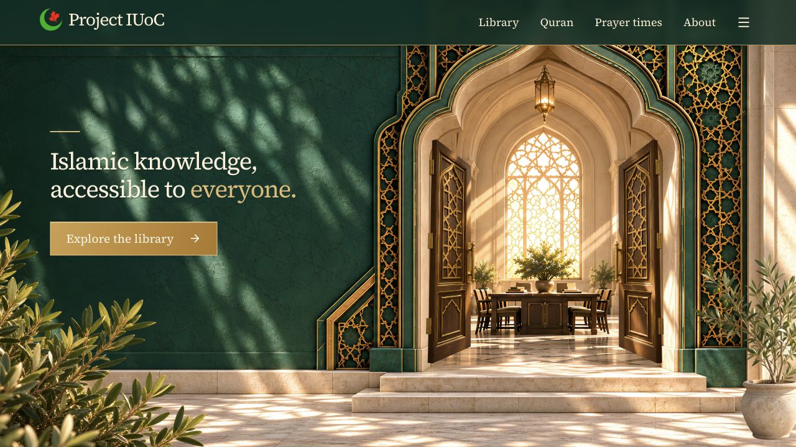
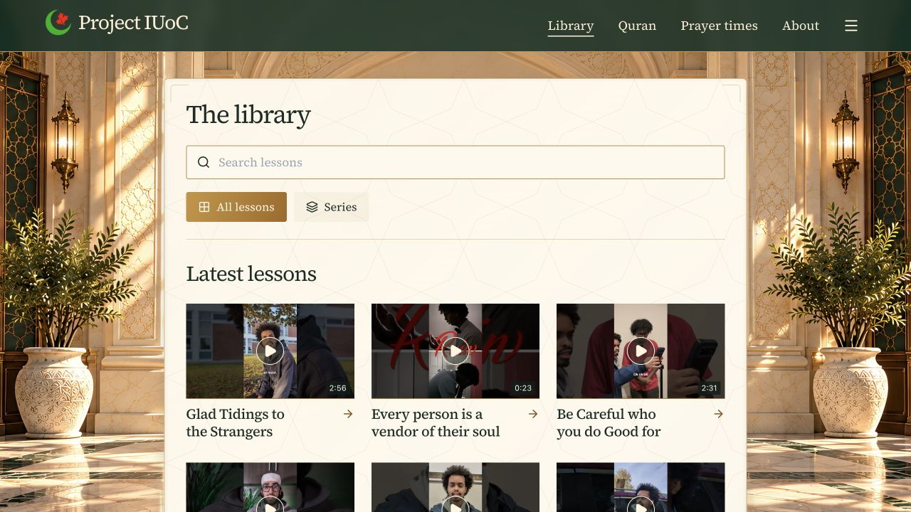
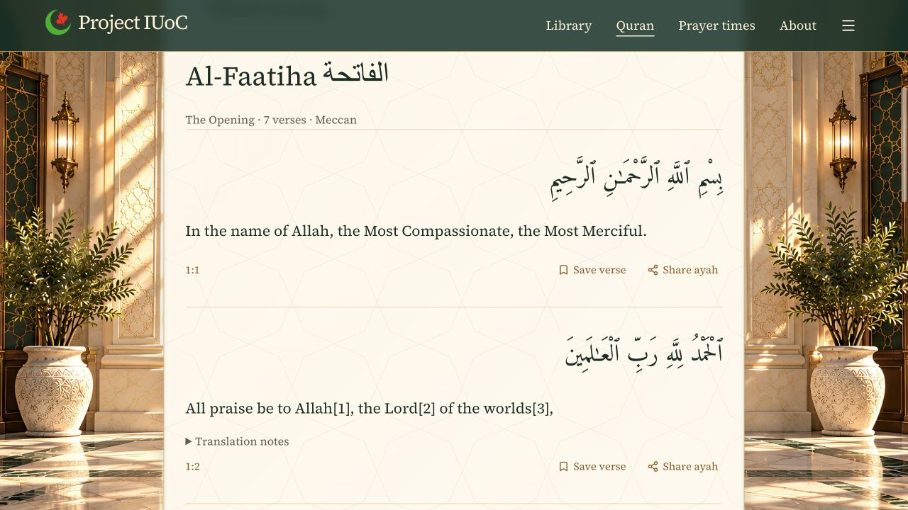

<h1 align="center">Project IUoC</h1>
<p align="center">A library of Islamic knowledge, with a little sense of place.</p>
<p align="center">
  <a href="https://iuoc.ca"><strong>Explore the website ↗</strong></a> ·
  <a href="https://moeabdulla.com/work/iuoc">Engineering case study</a> ·
  <a href="LICENSE">MIT licence</a>
</p>

[](https://iuoc.ca)

A searchable education library, Quran reader and everyday tools for [Project IUoC](https://www.youtube.com/@ProjectIUoC). Designed and built independently by [Mohammed Abdulla](https://moeabdulla.com) as volunteer work for the content team.

| Browse the library | Read and share an ayah |
| --- | --- |
| [](https://iuoc.ca/videos) | [](https://iuoc.ca/quran) |

**Next.js · TypeScript · React · Convex · Tailwind CSS · Bun**

## What it does

- Searchable lessons and series, with scheduled YouTube catalogue imports and manual editorial control.
- Quran reading with translations, optional tajweed colouring, bookmarks, daily verses, shareable images and direct verse links.
- Prayer times with selectable calculation methods, plus a daily question.
- A cinematic desktop entrance and a simpler, native-scrolling mobile experience. Shared loading/readiness logic handles image decoding and browser-history restoration.

## Engineering highlights

- **Import once, serve the catalogue.** A scheduled internal Convex action syncs YouTube metadata. Visitors query the database rather than spend YouTube quota. Editorial tags, featured lessons and series ordering survive imports.
- **A deliberate mobile tradeoff.** Desktop keeps the cinematic entrance; touch devices use native scrolling. Shared scene readiness handles decoded images, first load and return navigation.
- **Reading without catalogue requests.** Quran chapters and translations are versioned static files loaded on demand. Scripture stays unchanged; optional tajweed annotations are separate. Bookmarks and reading preferences stay in the browser.
- **Tested boundaries.** Tests exercise catalogue limits, cursor paging, internal-only ingestion, import failure handling, sharing, corpus reading and scene geometry. CI runs without production credentials.

## Find your way around

| Directory | Responsibility |
| --- | --- |
| `app/` | Routes, server rendering, metadata and sitemap |
| `components/courtyard/` | Entrance, shared page shells, artwork loading and library presentation |
| `components/daily/` | Quran, prayer, quiz and verse-sharing interfaces |
| `lib/courtyard/` | Scene geometry, renderers, readiness and motion lifecycle |
| `lib/daily/` | Reading state, share generation and browser-local preferences |
| `convex/` | Catalogue queries, schema and internal YouTube ingestion |
| `public/quran/` | Versioned chapter/translation data, hashes and source notices |
| `scripts/` | Corpus export and artwork preparation utilities |

Tests sit beside the logic they exercise. The companion mobile app is maintained separately and is not included here. Agent instructions and reusable skills live in `AGENTS.md`, `.agents/` and `.claude/`.

<details>
<summary>Earlier design explorations</summary>

Dated plans under `docs/superpowers/` preserve earlier iterations. They are historical design notes; the current README and application source take precedence.

</details>

## Run locally

Requires a current Node.js LTS release, Bun and a Convex account. Use your own development deployment rather than the live IUoC backend.

```sh
git clone https://github.com/moeabdulla/iuoc-web.git
cd iuoc-web
bun install --frozen-lockfile
cp .env.example .env.local
bun run dev
```

Follow Convex's setup prompt to create/select a development deployment. It supplies `CONVEX_DEPLOYMENT` and `NEXT_PUBLIC_CONVEX_URL`. Keep `NEXT_PUBLIC_SITE_URL=http://localhost:3000` locally.

For ingestion, set `YOUTUBE_API_KEY`, `YOUTUBE_CHANNEL_ID` and `YOUTUBE_UPLOADS_PLAYLIST_ID` in that **Convex deployment's environment settings**. The YouTube key stays on the backend. An empty development database can render the site before ingestion is configured.

```sh
bun run test       # unit tests
bun run lint       # ESLint
bun run typecheck  # Next route types + strict TypeScript
bun run build     # production build against your configured backend
```

## Backend and deployment

Ingestion runs four times daily at 01:00, 16:00, 19:00 and 22:00 UTC. These are fixed UTC times, not daylight-saving-aware Eastern times. Imports preserve video tags, featured flags and playlist ordering/visibility; editors manage those fields through the Convex dashboard.

Public Convex functions read the catalogue with validated inputs and capped requests. Imports and database writes use internal functions. Timeouts, repeat-token detection and a per-run request budget prevent runaway ingestion; an unsuccessful upstream fetch cannot prune the catalogue.

The production Vercel build deploys Convex before building Next.js. Production deployment requires private environment configuration and is not part of local setup. See [`SECURITY.md`](.github/SECURITY.md) for credential boundaries and [`THIRD_PARTY_NOTICES.md`](docs/THIRD_PARTY_NOTICES.md) for bundled content.

## Reuse and licensing

The original application code and documentation are [MIT licensed](LICENSE): you can study, modify and reuse them, including commercially. Bundled Quran text, translations, annotations and third-party assets retain their own terms; see [third-party notices](docs/THIRD_PARTY_NOTICES.md).

Run forks against **your own Convex deployment and YouTube API key**. The code licence does not grant access to IUoC's hosted backend, credentials or API quota. No production keys are included.
